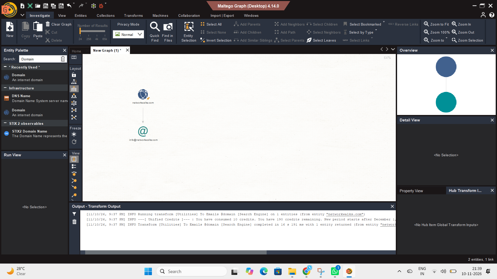

# Module 1 — Footprinting & Reconnaissance

## Objective
Perform footprinting and reconnaissance against a lab target using tools available in Kali Linux.

**Target domain:** `networkwalks.com`

**Tools used:** WHOIS · WhatWeb · NSLookup · cURL · WAFW00F · DNSRecon

> ⚠️ All activity was performed for educational purposes against a lab-designated target.

---

## Task 1 — WHOIS

**Command**
```bash
whois networkwalks.com
```

**Purpose:** Retrieve public domain registration details such as registrar, dates and name servers.

**Key Results**

| Field | Value |
|---|---|
| Domain | NETWORKWALKS.COM |
| Registrar | GoDaddy.com, LLC |
| Creation Date | 2019-11-06 |
| Expiry Date | 2027-11-06 |
| Name Servers | NS6135.HOSTGATOR.COM, NS6136.HOSTGATOR.COM |
| DNSSEC | Unsigned |


---

## Task 2 — WhatWeb

**Command**
```bash
whatweb networkwalks.com
```

**Purpose:** Identify technologies and services used by the target website.

**Observed Information**

| Item | Value |
|---|---|
| Web Server | Apache |
| IP Address | 192.232.216.135 |
| CMS | WordPress |
| WordPress Download Manager | 3.3.76 |
| jQuery | 3.7.1 |
| Bootstrap | 7.1.4 (as reported by WhatWeb) |
| Other | Google Tag Manager, HTML5 |
| Title | Networkwalks Academy |
| Redirect | HTTP → HTTPS (301) |


---

## Task 3 — NSLookup

**Command**
```bash
nslookup networkwalks.com
```

**Purpose:** Resolve the domain name to its IP address.

**Results**

| Item | Value |
|---|---|
| DNS Server | 8.8.8.8 |
| Resolved IP | 192.232.216.135 |


---

## Task 4 — HTTP Response Headers

**Command**
```bash
curl -I networkwalks.com
```

**Purpose:** Inspect the HTTP response headers returned by the target.

**Observed Information**
- Status: `HTTP/1.1 301 Moved Permanently`, redirecting to `https://networkwalks.com/`
- `Server: Apache`
- `X-Redirect-By: WordPress - Really Simple Security`
- `X-nginx-cache: WordPress`
- `Content-Type: text/html; charset=UTF-8`
- Cookie set: `__wpdm_client` (HttpOnly)
- `Referrer-Policy: no-referrer-when-downgrade`
- `Permissions-Policy` present
- Cache headers: `Cache-Control: max-age=3600`, `Expires`, `X-Endurance-Cache-Level`


---

## Task 5 — Web Application Firewall Detection

**Command**
```bash
wafw00f networkwalks.com
```

**Purpose:** Determine whether a WAF protects the target.

**Result:** The site `https://networkwalks.com` is behind **ModSecurity (SpiderLabs)** WAF.


---

## Task 6 — DNS Enumeration

**Command**
```bash
dnsrecon -d networkwalks.com
```

**Purpose:** Enumerate publicly available DNS information.

**Records Observed**

| Type | Value |
|---|---|
| NS | ns6135.hostgator.com (50.87.144.87), ns6136.hostgator.com (192.232.216.131) |
| MX | mail.networkwalks.com (192.232.216.135) |
| A | networkwalks.com → 192.232.216.135 |
| TXT | Google site verification; SPF record (`v=spf1 +a +mx ...`) |
| SRV | `_autodiscover._tcp` → cpanelemaildiscovery.cpanel.net (8 records) |

**Notes:** The SOA lookup timed out and no DNSSEC answer was returned. The tool reported **8 Records Found** in the SRV enumeration.


---

## Skills Practiced
- Domain footprinting
- Web technology fingerprinting
- DNS enumeration
- HTTP header analysis
- WAF detection
- IP address identification
- Reconnaissance with Kali Linux command-line tools

# Module 3 — Footprinting with Maltego

## Objective
Install Maltego on a Windows computer and use it to perform OSINT footprinting by discovering email addresses associated with a target domain.

**Target domain:** `networkwalks.com` (lab-designated target, used with due permission)

**Tool used:** Maltego Graph (Desktop) 4.14.0 — Community Edition

> ⚠️ This lab was performed for educational purposes only, against a lab-designated target.

---

## Task 1 — Download & Install Maltego on Windows

**Purpose:** Set up Maltego, a graphical OSINT and link-analysis tool, on a Windows machine.

**Steps performed**
1. Downloaded Maltego Graph for Windows from the official website (https://maltego.com).
2. Ran the setup as administrator and completed the installer (including the Java Runtime prerequisite).
3. Launched Maltego and chose **Maltego ID** activation (online).
4. Created a free Maltego ID and logged in through the browser.
5. Completed the configuration wizard with the default settings (Utilities transforms, default system browser, Privacy Mode: Normal).
6. Opened a blank graph, confirming Maltego was ready to run transforms.

**Result**

| Item | Value |
|---|---|
| Operating System | Windows |
| Application | Maltego Graph (Desktop) |
| Version | 4.14.0 |
| Activation | Maltego ID (free account) |
| Privacy Mode | Normal |
| Status | Installed and ready to run transforms |


---

## Task 2 — Find Email Addresses Related to the Target Domain

**Purpose:** Use a Maltego transform to harvest publicly available email addresses linked to `networkwalks.com`.

**Steps performed**
1. Searched for **Domain** in the Entity Palette and dragged it onto the graph.
2. Double-clicked the entity and renamed it to `networkwalks.com`.
3. Right-clicked the entity, filtered for `email`, and ran the transform:
   `[Utilities] To Emails @domain [Search Engine]`

**Transform output**
- The transform ran on 1 entity (`networkwalks.com`).
- It completed in about 16 seconds and returned 1 entity.
- It consumed 10 credits (190 remaining on the free account).

**Result**

| Entity Type | Value |
|---|---|
| Domain | networkwalks.com |
| Email Address | info@networkwalks.com |

The graph shows 2 entities and 1 link: the domain connected to the discovered email address.



---

## Why This Matters
Email addresses discovered during footprinting help an attacker identify contacts for phishing or social engineering, and combined with other reconnaissance (such as the WordPress fingerprint found in Module 1) they help select technology-specific attacks. Defenders can use the same technique to see what an organization exposes publicly.

## Notes
- Maltego has many other transforms (DNS lookups, WHOIS details, person-from-domain, and more) that can be explored for further footprinting.
- Maltego graphs can be exported to CSV, XLSX, image and PDF formats.

## Skills Practiced
- OSINT and passive footprinting
- Installing and configuring security tools on Windows
- Link analysis and graph-based investigation
- Email address enumeration
- Using transforms and understanding data-source credit limits