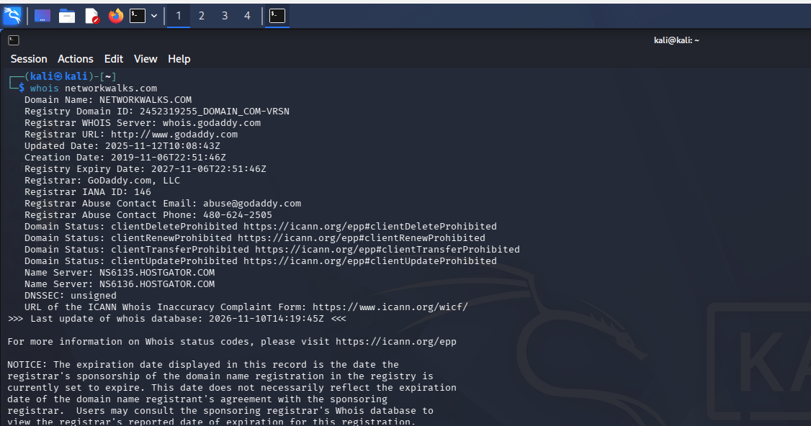
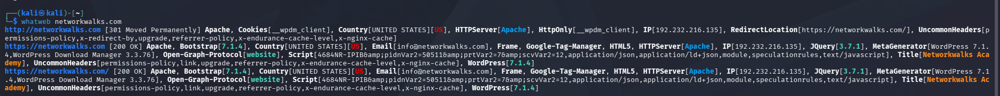
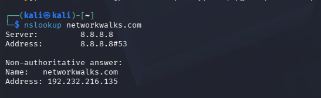
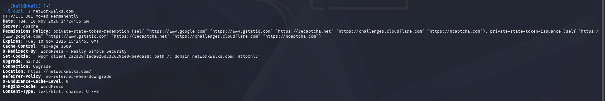
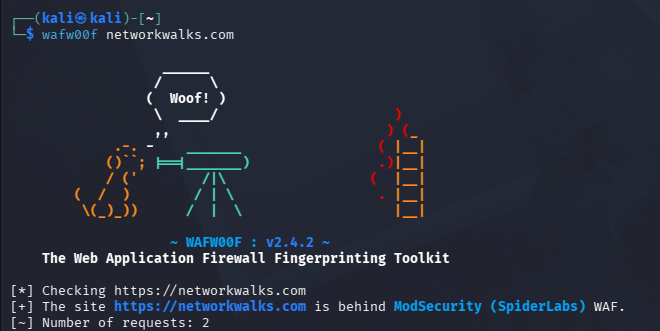
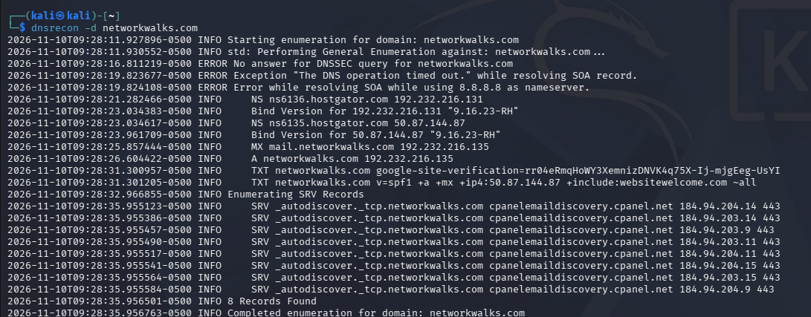

# Module 1 — Footprinting & Reconnaissance

## Objective
Perform footprinting and reconnaissance against a lab target using tools available in Kali Linux.

**Target domain:** `networkwalks.com`

**Tools used:** WHOIS · WhatWeb · NSLookup · cURL · WAFW00F · DNSRecon

> ⚠️ All activity was performed for educational purposes against a lab-designated target.

---

## Task 1 — WHOIS

**Command**
```bash
whois networkwalks.com
```

**Purpose:** Retrieve public domain registration details such as registrar, dates and name servers.

**Key Results**

| Field | Value |
|---|---|
| Domain | NETWORKWALKS.COM |
| Registrar | GoDaddy.com, LLC |
| Creation Date | 2019-11-06 |
| Expiry Date | 2027-11-06 |
| Name Servers | NS6135.HOSTGATOR.COM, NS6136.HOSTGATOR.COM |
| DNSSEC | Unsigned |



---

## Task 2 — WhatWeb

**Command**
```bash
whatweb networkwalks.com
```

**Purpose:** Identify technologies and services used by the target website.

**Observed Information**

| Item | Value |
|---|---|
| Web Server | Apache |
| IP Address | 192.232.216.135 |
| CMS | WordPress |
| WordPress Download Manager | 3.3.76 |
| jQuery | 3.7.1 |
| Bootstrap | 7.1.4 (as reported by WhatWeb) |
| Other | Google Tag Manager, HTML5 |
| Title | Networkwalks Academy |
| Redirect | HTTP → HTTPS (301) |



---

## Task 3 — NSLookup

**Command**
```bash
nslookup networkwalks.com
```

**Purpose:** Resolve the domain name to its IP address.

**Results**

| Item | Value |
|---|---|
| DNS Server | 8.8.8.8 |
| Resolved IP | 192.232.216.135 |



---

## Task 4 — HTTP Response Headers

**Command**
```bash
curl -I networkwalks.com
```

**Purpose:** Inspect the HTTP response headers returned by the target.

**Observed Information**
- Status: `HTTP/1.1 301 Moved Permanently`, redirecting to `https://networkwalks.com/`
- `Server: Apache`
- `X-Redirect-By: WordPress - Really Simple Security`
- `X-nginx-cache: WordPress`
- `Content-Type: text/html; charset=UTF-8`
- Cookie set: `__wpdm_client` (HttpOnly)
- `Referrer-Policy: no-referrer-when-downgrade`
- `Permissions-Policy` present
- Cache headers: `Cache-Control: max-age=3600`, `Expires`, `X-Endurance-Cache-Level`



---

## Task 5 — Web Application Firewall Detection

**Command**
```bash
wafw00f networkwalks.com
```

**Purpose:** Determine whether a WAF protects the target.

**Result:** The site `https://networkwalks.com` is behind **ModSecurity (SpiderLabs)** WAF.



---

## Task 6 — DNS Enumeration

**Command**
```bash
dnsrecon -d networkwalks.com
```

**Purpose:** Enumerate publicly available DNS information.

**Records Observed**

| Type | Value |
|---|---|
| NS | ns6135.hostgator.com (50.87.144.87), ns6136.hostgator.com (192.232.216.131) |
| MX | mail.networkwalks.com (192.232.216.135) |
| A | networkwalks.com → 192.232.216.135 |
| TXT | Google site verification; SPF record (`v=spf1 +a +mx ...`) |
| SRV | `_autodiscover._tcp` → cpanelemaildiscovery.cpanel.net (8 records) |

**Notes:** The SOA lookup timed out and no DNSSEC answer was returned. The tool reported **8 Records Found** in the SRV enumeration.



---

## Skills Practiced
- Domain footprinting
- Web technology fingerprinting
- DNS enumeration
- HTTP header analysis
- WAF detection
- IP address identification
- Reconnaissance with Kali Linux command-line tools